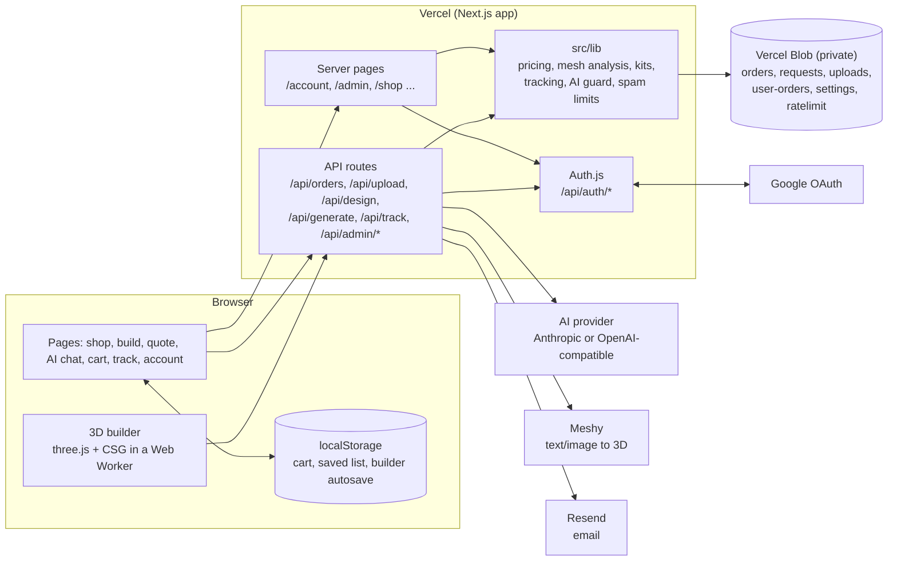
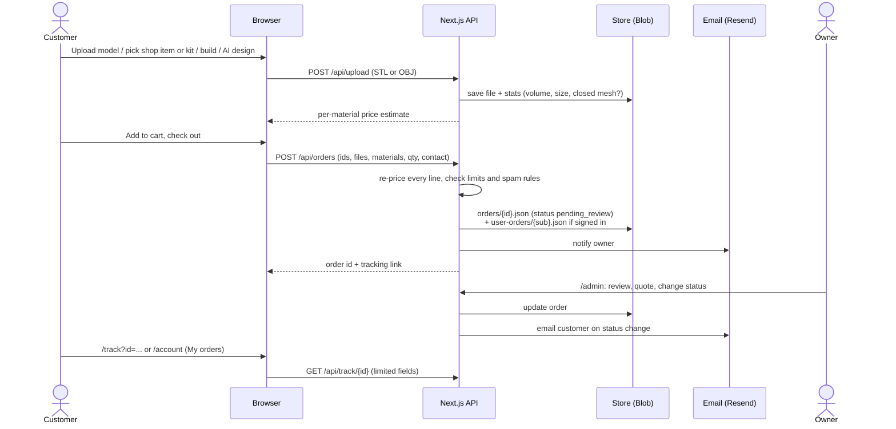
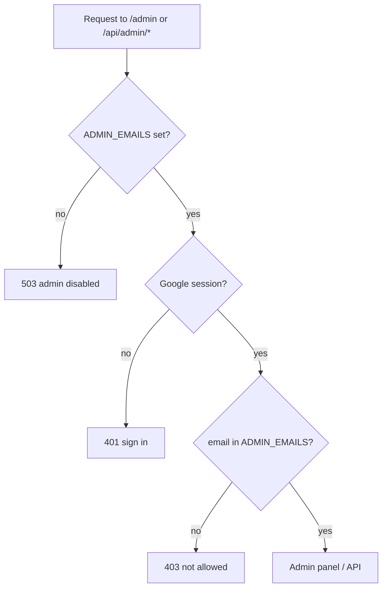

# PrintPro3D

Made-to-order 3D printing for India, run from Patna, Bihar. Live at **https://printpro3d.vercel.app**.

A customer uploads a model, picks a ready-made part or kit, builds one from shapes, or asks AI to draw it. They get a price, put it in a cart, check out once and track the order. The owner reviews, quotes, prints, ships and moves the order through its stages from `/admin`.

| | |
| --- | --- |
| **Stack** | Next.js 16 (App Router), React 19, TypeScript, Tailwind 4, three.js / react-three-fiber, `three-bvh-csg` |
| **Hosting** | Vercel, deployed from `main` |
| **Storage** | Private Vercel Blob store (no database); local folders in development |
| **Sign-in** | Google via Auth.js (`next-auth` v5); admin limited to `ADMIN_EMAILS` |
| **Tests** | `node:test`, about 400 unit and flow tests; CI runs type-check, tests and a production build |

**Status:** live and working end to end. No online payment yet: orders are saved as `pending_review` and the owner confirms before asking for payment. Material rates and fees in `src/lib/quote.ts` are placeholders until the owner approves real prices. Open items: [context/GAPS.md](context/GAPS.md), [context/OWNER-CHECKLIST.md](context/OWNER-CHECKLIST.md).

> AI assistants and new developers: read [context/README.md](context/README.md) first.

## Contents

- [Architecture](#architecture)
- [How an order flows](#how-an-order-flows)
- [Sign-in and admin](#sign-in-and-admin)
- [Features](#features)
- [Run locally](#run-locally)
- [Environment](#environment)
- [Deploy](#deploy)
- [Owner tasks](#owner-tasks)
- [Project layout](#project-layout)
- [Security](#security)
- [Further reading](#further-reading)

## Architecture

One Next.js app does everything: pages, API routes and server-side pricing. There is no separate backend and no database. Records are JSON files in a storage layer (`src/lib/store.ts`) that writes to a private Vercel Blob store in production and to local folders in development.



Key ideas:

- **The server owns prices.** The browser shows live estimates, but checkout sends only item ids, files, materials and quantities. `/api/orders` re-prices everything (`quote.ts`, `orderPricing.ts`) and ignores client totals.
- **Every feature is its own route,** so three.js and the AI chat load only where they are used. The home page ships about 110 kB of JS.
- **Storage is one small API** (put/get/list/delete JSON and binary) over three backends:

  | Backend | When |
  | --- | --- |
  | Local disk under `DATA_DIR` (default: project root) | development, self-hosting |
  | Private Vercel Blob | `BLOB_READ_WRITE_TOKEN` set (production) |
  | `os.tmpdir()` | on Vercel without a Blob token: data is lost, demo only |

- **Meshes are checked on the server.** Uploaded STL/OBJ files are parsed for volume, bounding box, bed fit and whether they are closed. Open or non-manifold meshes are not auto-priced; they become a manual quote. Kit and shop meshes are precomputed at build time (`scripts/precompute-meshes.ts`).
- **Optional services switch on by key.** Without keys, quoting, the shop, the builder, cart, checkout and tracking all work. AI drawing, Meshy and email turn on when their keys are set.

## How an order flows



Order stages: `pending_review` → `needs_manual_quote` / `quoted` → `awaiting_payment` → `paid` → `printing` → `shipped` → `delivered` (or `cancelled`). Design requests: `new` → `designing` → `quote_sent` → `approved` (or `cancelled`). Source: `src/lib/tracking.ts`.

## Sign-in and admin

Customers can sign in with any verified Google account to see their orders on `/account`. Only the emails in `ADMIN_EMAILS` can open `/admin`, `/settings/ai` (in production) and the `/api/admin/*` routes. There is no admin password or token.



- Sessions are JWT cookies with no database (`src/auth.ts`). The session id is Google's stable account id, so a customer's orders stay linked across sign-ins.
- Orders and requests placed while signed in store the owner's id and email from the session, never from the form. `/account` lists only those records (plus pre-account orders that match the verified email).
- The admin gate is `src/lib/adminAuth.ts`; the customer side is `src/lib/account.ts`.

## Features

| Area | Route | What it does |
| --- | --- | --- |
| Shop | `/shop`, `/shop/[id]` | Parametric parts with live 3D previews and size fields, plus kits (drone, RC cars, robots, transformer, desk pet and more) with per-part plates, a finished-build view and licence credits |
| Quote | `/quote`, `/upload` | Upload STL or OBJ, see size, volume and price per material |
| Build | `/playground`, `/blueprint/[id]` | Compose shapes (solid or hole), CSG in a Web Worker, drone hover simulation, part suggestions, blueprint pages with approve and finalize |
| AI | `/ai`, AI button on every page | Describe or photograph a part, get a shape model with a live preview, refine it, then edit or price it. Meshy organic 3D is a tab when its key is set |
| Request | `/request` | "Design this for me" with pictures |
| Cart | `/cart` | Cart and saved list in the browser; one-request checkout |
| Track | `/track` | Order and request status by id |
| Account | `/account` | Google sign-in, My orders |
| Admin | `/admin`, `/settings/ai` | Orders and requests with filters, search, notes, CSV export, file downloads; AI provider settings |
| Info | `/materials`, `/how-it-works`, `/about`, `/contact`, `/privacy`, `/credits` | Static pages |

Service area: India only. Checkout asks for an Indian state and a 6-digit PIN (`src/lib/shipping.ts`). Electronics in kits are enquiry-only until the owner sets prices.

## Run locally

Node 22.18 or newer (CI and Vercel use Node 26).

```bash
npm install
```

```bash
cp .env.example .env.local
```

```bash
npm run dev
```

Then open http://localhost:3000. All keys are optional.

```bash
npm test
```

```bash
npm run build && npm start
```

Notes for local work:

- AI runs without an API key if the `claude` CLI is on your PATH (development only; never in production).
- No daily AI cap under `npm run dev`.
- Google sign-in locally needs `http://localhost:<port>/api/auth/callback/google` registered on the OAuth client, plus the `AUTH_*` and `ADMIN_EMAILS` variables in `.env.local`.

## Environment

Every variable is listed with a comment in [.env.example](.env.example). Keys are read on the server only; never commit `.env*` files (`.env.example` excepted).

| Variable | Needed for |
| --- | --- |
| `AUTH_SECRET`, `AUTH_GOOGLE_ID`, `AUTH_GOOGLE_SECRET` | Google sign-in |
| `ADMIN_EMAILS` | Comma-separated Google emails allowed into admin (unset = admin disabled) |
| `BLOB_READ_WRITE_TOKEN` | Durable storage on Vercel (private Blob store) |
| `LEGACY_FILES_PUBLIC` | Unset or `1`: files stored before per-file owners (2026-11-27 12:40 UTC) stay readable by their link, as before. `0`: lock them (admin, or the customer's own signed-in order). Newer files always need their owner, admin or an Orrery token |
| `ANTHROPIC_API_KEY` | AI drawing with Anthropic; or `AI_PRESET` + `AI_API_KEY` + `AI_MODEL` for an OpenAI-compatible provider |
| `AI_DESIGN_TIER`, `AI_DESIGN_MODEL`, `AI_REVISIONS_PER_PROJECT`, `AI_DAILY_PER_EMAIL`, `AI_DAILY_TOTAL` | AI model tier and caps |
| `MESHY_API_KEY` | Meshy text/image to 3D |
| `RESEND_API_KEY`, `ORDER_NOTIFY_TO`, `ORDER_NOTIFY_FROM`, `SITE_URL` | Owner email on new orders, customer email on status changes |
| `DATA_DIR` | Where local files go (default: project root) |

The AI provider, model and base URL can also be chosen in `/admin` (saved in the store, overrides the `AI_*` variables; keys stay in env only).

## Using Print Pro 3D from Orrery

Orrery (the owner's chat app) can call this site as an app: generate an STL from a prompt, poll the job, open the quote page. The manifest is always served; `/api/mcp` and `/api/orrery/*` answer 503 until `ORRERY_APP_SECRET` is set.

| Variable | Meaning |
| --- | --- |
| `ORRERY_APP_SECRET` | Shared HS256 secret, shown once by Orrery at registration |
| `ORRERY_APP_ID` | App id, default `printpro3d` (token `aud`) |
| `ORRERY_ISSUER` | Token `iss`, default `orrery` |
| `NEXT_PUBLIC_ORRERY_URL` | Orrery's URL; shows the "Part of Orrery / Open Orrery" strip (hidden when unset) |
| `NEXT_PUBLIC_SITE_URL` | This site's production origin for the manifest; falls back to `SITE_URL`, `AUTH_URL`, `VERCEL_PROJECT_PRODUCTION_URL`, then `https://printpro3d.vercel.app` |

Registration: deploy, then in Orrery open Settings > Apps and enter `https://<this site>/.well-known/orrery-app.json`. Review the preview (tools `generate_model`, which spends Meshy credit so Orrery asks before each run, and read-only `job_status`), approve, copy the secret Orrery shows once, set `ORRERY_APP_SECRET` (and `ORRERY_ISSUER=orrery`) on Vercel and redeploy.

- `POST /api/mcp`: minimal stateless MCP (JSON-RPC over HTTP). Each call needs an Orrery bearer token; `sub` is the user's email and the usual per-email daily quota (`AI_DAILY_PER_EMAIL`) is counted on it.
- `GET /api/orrery/file?name=<stl>`: STL bytes, bearer token required, and only files made by that user's own jobs.
- `/sso?token=&next=`: Orrery's 60 s single-use handoff signs the user in (Auth.js `orrery` provider) and redirects to a same-origin path. It never grants admin.
- `/quote?file=<stl>` (or `?job=<id>`) preselects a model the signed-in user generated.

## Deploy

Pushes to `main` deploy to Vercel. GitHub Actions (`.github/workflows/ci.yml`) runs `tsc`, the tests and `npm run build` on every push.

First-time setup:

1. Import the GitHub repo in Vercel.
2. Storage: create a **private** Blob store and connect it (sets `BLOB_READ_WRITE_TOKEN`). Without it, orders are lost between requests.
3. Set `AUTH_SECRET`, `AUTH_GOOGLE_ID`, `AUTH_GOOGLE_SECRET`, `ADMIN_EMAILS`, `SITE_URL`, and any AI, Meshy and Resend keys.
4. On the Google OAuth client, add `https://<your-domain>/api/auth/callback/google` as a redirect URI.
5. Deploy.

Vercel refuses request bodies over 4.5 MB, so in Blob mode files over 4 MB upload from the browser straight to Blob (`/api/upload/blob`) and the server then validates them (`/api/upload/finalize`).

## Owner tasks

```bash
npm run order:status -- <order-id> <status>
```

Moves an order to a new stage and emails the customer. `/admin` does the same in the browser.

```bash
npm run ai:models
```

Lists the models the configured AI provider offers.

```bash
npm run designs:prune
```

Deletes unordered design projects older than 30 days (run weekly).

## Project layout

```
src/app/              one folder per page; API routes under src/app/api
src/components/       page components, Navbar, Footer, 3D scenes, admin panel
src/lib/              pricing, mesh analysis, cart, tracking, kits, AI, storage,
                      auth gates, email; pure logic with *.test.ts next to it
src/lib/kits/         one file per kit (parts, plates, credits)
src/auth.ts           Auth.js config (Google, JWT sessions)
public/models/kits/   kit STLs with LICENSE and CREDITS.md per kit
scripts/              owner CLI and build-time mesh precompute
context/              project brief, architecture, decisions, gaps, operations
```

## Security

- Prices are always recomputed on the server.
- Admin is Google sign-in with an email allowlist only; signed-in customers get 403 on admin routes.
- Order ownership comes from the session, never from form fields.
- AI and other API keys stay on the server. The `claude-cli` AI provider is development only and is refused in production.
- Uploaded files get random names, are not publicly listable and are served to the owner through an admin route.
- Spam: honeypot field, per-IP hourly limits on orders, uploads and AI calls, per-email and global daily AI caps.
- Sign-out accepts same-origin requests only.

## Further reading

| File | What is in it |
| --- | --- |
| [context/README.md](context/README.md) | Project brief: start here |
| [context/ARCHITECTURE.md](context/ARCHITECTURE.md) | Module-level detail: flows, pricing, storage, AI, security rules |
| [context/DECISIONS.md](context/DECISIONS.md) | Why things are the way they are |
| [context/OPERATIONS.md](context/OPERATIONS.md) | Routes, APIs, caps, deploy notes |
| [context/GAPS.md](context/GAPS.md) | What is not done yet |
| [context/OWNER-CHECKLIST.md](context/OWNER-CHECKLIST.md) | What the owner still needs to provide |
